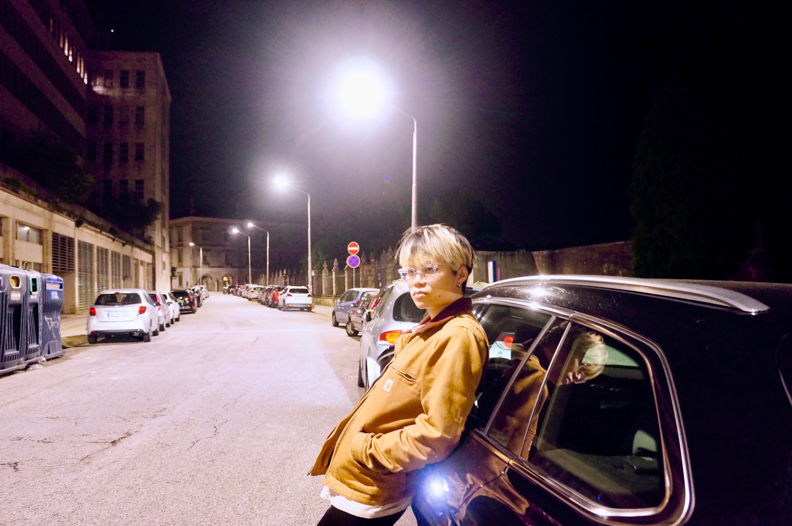

{: width="100%"}

I am currently a third-year PhD Student at the ECE Department at UIUC. I have a strong passion for both teaching and research. I am generally interested in theoretical explanations for machine learning phenomena, with a focus on privacy implications. I am very fortunate to be currently advised by [Daniel Alabi](https://alabidan.me){:target="_blank"}. Outside of my academic pursuits I love to talk basketball and social deduction games.
